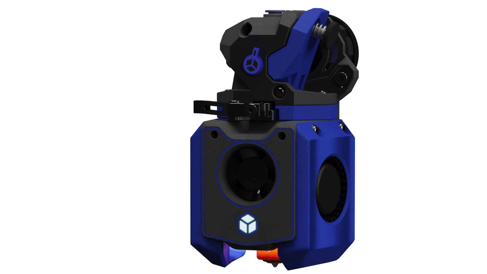
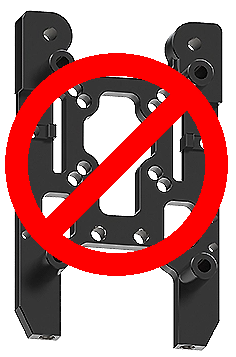

# A4Tv2: A new version of [A]nother [4]01x [T]oolhead

[![CC BY-NC-SA 4.0][cc-by-nc-sa-shield]][cc-by-nc-sa]

A4Tv2 is a new version of [A4T](https://github.com/DW-Tas/A4T), from:  [DW-Tas](https://github.com/DW-Tas)

> [!TIP]
> **A4Tv2 is a prerelease.** This design is still in development and should be treated as experimental. It is not a fully documented release.

## Documentation and assembly

A basic illustrated [A4Tv2 toolhead assembly guide](docs/toolhead_build.md) is now available. It covers preparation of the printed parts, fan and duct installation, hotend and extruder assembly, wiring, and mounting the completed toolhead to the carriage.

A4Tv2 remains a prerelease, so the guide and hardware details may change as development continues. Check that the instructions and fastener lengths are suitable for your selected hotend, extruder, ducts, and carriage before assembly.

> [!WARNING]
>## UHF hotend screw warning
>
>The UHF versions, including Rapido X, use shortened M2.5 SHCS screws (previously countersunk screws) to hold the hotend to the main body.  
>The wedge shape of a countersunk screw did put outward force on the printed plastic and caused it to split. These were replaced on the 24th of October with versions using shorter SHCS instead. Treat these versions as experimental and inspect the printed part for cracking or deformation. Feedback encouraged.

## Pre-requisites
A printer that fits either Xol carriage, or a standard voron CW2 or Tap carriage. `NOT cartographer CNC carriage (see warning below)` 
 
To avoid build plate area loss:
- X/Y gantry joints that are within the same size as standard Voron 2.4 or Trident X/Y joints.
- Slimmer than stock idlers (see warning below) 

See Voron Design instructions to install TAP. 
`If using tap, highly recommended to replace M3x50 SHCS with button head screws for better build plate clearance.` 

> [!NOTE] 
> ### Notes for Xol-Carriage 
> * Xol-Carriage documentation is here: https://github.com/Armchair-Heavy-Industries/Xol-Toolhead/blob/main/docs/xol_carriage_assembly.md 
> * A4T uses standard length probe modules for Xol-Carriage (even with UHF hotends in A4T). 
> * Monolith Gantry users should go with the Monolith specific Xol-Carriage mod: [Monolith_Xol-Carriage](https://github.com/Armchair-Heavy-Industries/Armchair-Usermods/tree/main/files/Xol-Toolhead/Monolith_Xol-Carriage) 

  

> [!WARNING]
> ### Front Idlers  
> A4T can collide with the stock voron front idlers for older Trident (pre-R2) and current v2.4 when the toolhead is in the front corners of the build area. This can cause issues with the homing sequence when homing X if the toolhead is at the front of the gantry on Y.   
> Fully compatible idlers: 
> * clee's [BFI (Beefy Front Idlers)](https://github.com/clee/VoronBFI)   
> * Ramalama2's [Front Idlers](https://github.com/Ramalama2/Voron-2-Mods/tree/main/Front_Idlers) 
> * Voron Trident R2 stock idlers  

  

> [!WARNING]
> ### Cartographer CNC carriage  
>  The Cartographer CNC carriage is made for StealthBurner, not A4T. The probe will sit too low if used with A4T unless you have the tools and skill necessary to remove ~1.8mm off the bottom of the Cartographer CNC carriage mounting points where the probe attaches.

 

## Files

- `CAD/` contains STEP files, including the A4Tv2 assembly STEP and ZIP exports.
- `STL/` contains exported STL files.
- `3MF/` contains exported 3MF files.

## Fan Options

- **`4015:`** Finding *GOOD* 4015 fans is a challenge. Peopoly [Magneto X Lancer Extruder Side Turbo Fans](https://peopoly.net/products/magneto-x-lancer-extruder-side-turbo-fan?variant=50568975810842) have amazing flow and pressure (not far of 5015s), but, they require hardware PWM and slicer configuration to compensate for slow spin up time (around 1 second).

  ⚠️ *These fans are single-source, so availability can be inconsistent and shipping costs can be quite high.*

- **`4010:`** Two duct options are available:
  - **Backflow inhibitor built into duct:** Designed for GDStime 12k 4010 fans, with the backflow inhibitor built in. Take the front off the fan before installing into the duct.
  - **Generic duct:** Fits most 4010 fans. Requires backflow inhibitors to be installed in the same way as A4T. Good for reusing fans with inhibitors already glued in place.

  
> [!TIP] 
> ### You can help support the development of this project. 
> Donate at https://ko-fi.com/dwtas 

  

This work is licensed under a
[Creative Commons Attribution-NonCommercial-ShareAlike 4.0 International License][cc-by-nc-sa].

[![CC BY-NC-SA 4.0][cc-by-nc-sa-image]][cc-by-nc-sa]

[cc-by-nc-sa]: http://creativecommons.org/licenses/by-nc-sa/4.0/
[cc-by-nc-sa-image]: https://licensebuttons.net/l/by-nc-sa/4.0/88x31.png
[cc-by-nc-sa-shield]: https://img.shields.io/badge/License-CC%20BY--NC--SA%204.0-lightgrey.svg

### License clarification regarding non-commercial use:
The non-commercial aspect of this license is for cases where A4Tv2 is the product, not the use of A4Tv2 to create products. 
For example, if you wish to sell A4Tv2 as a product, you would need to seek a commercial license before doing so.  
It is NOT intended to prevent the use of A4Tv2 in a printer that you use to provide commercial services. If you want to run A4Tv2 as a toolhead for your print farm printers, go right ahead.